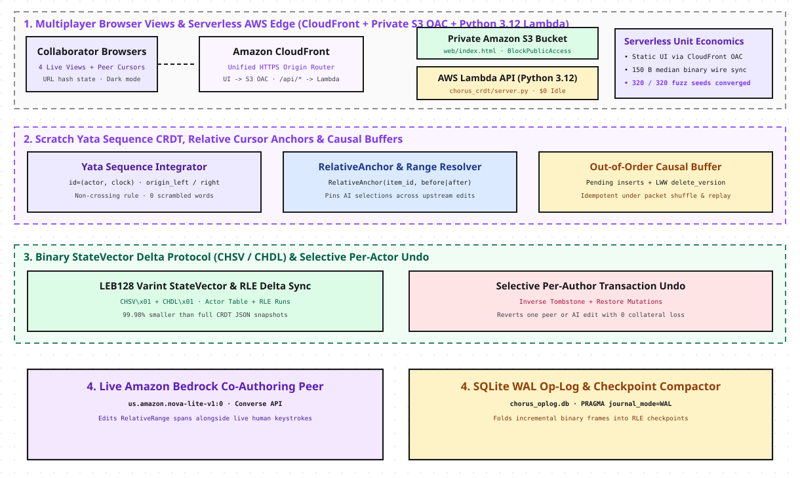

# ChorusCRDT: Multiplayer Human + AI Document Workspace, Sequence CRDT & Selective Causal Undo

- **Live CloudFront Studio**: https://d8786633yc2ef.cloudfront.net
- **Live `/api/health` Endpoint**: https://d8786633yc2ef.cloudfront.net/api/health
- **GitHub Repository**: https://github.com/ritwikareddykancharla/chorus-crdt-collab

ChorusCRDT is a multiplayer document workspace built for shared human and AI co-authoring, deployed serverlessly on **Amazon CloudFront + Private S3 (OAC) + AWS Lambda (serverless) + SQLite WAL + Amazon Bedrock (`us.amazon.nova-lite-v1:0`)**.



## 01 · Problem

When engineers and AI teammates edit the same technical specification simultaneously, naive offset-based editors fail in four ways:

1. **Stale Character Offsets**: An LLM takes 400 to 700 ms to rewrite a paragraph. If a human collaborator types 50 characters above that paragraph in the meantime, applying the AI response at raw integer offsets slices into the wrong text.
2. **Interleaved Concurrent Words**: When multiple collaborators insert words at the same cursor boundary across an unstable connection, naive merges scramble letters or diverge under packet reordering.
3. **Full-Snapshot Wire Bloat**: Re-sending full CRDT JSON item arrays on every reconnect transmits megabytes of metadata instead of minimal missing operations.
4. **Global Linear Undo Collisions**: Reverting an AI edit via a global undo stack accidentally erases edits typed afterward by human teammates.

## 02 · Architecture & Implementation

- `chorus_crdt/yata_engine.py`: Implements `CRDTItem(id=(actor_id, lamport_clock), origin_left, origin_right, text, deleted, author_kind)` from scratch using Yata's non-crossing origin rule, causal out-of-order pending buffers, idempotent deduplication, and `RelativeAnchor(item_id, bias)` / `RelativeRange` cursor pinning.
- `chorus_crdt/wire_sync.py`: Encodes unsigned LEB128 varint `StateVector` frames (`CHSV\x01`) and run-length packed binary operation deltas (`CHDL\x01`) with deduplicated actor and transaction tables, backed by `SQLiteCRDTStore` WAL logging and checkpoint compaction.
- `chorus_crdt/fuzzer.py`: Runs 320 deterministic randomized seeds across 4 concurrent human and AI replicas under split-brain partitions, packet shuffling, duplicate replay, and packet drops recovered via `StateVector` deltas.
- `chorus_crdt/ai_collaborator.py` & `chorus_crdt/server.py`: Coordinates live `us.amazon.nova-lite-v1:0` Converse API co-editing on pinned `RelativeRange` spans alongside concurrent human edits, supports selective per-author transaction undo (`undo_actor`), and serves `/api/*` behind CloudFront.

## 03 · Benchmarks (`benchmarks/latest_results.json`)

Measured by `python3 benchmarks/run_benchmarks.py`:

| Metric | Value | Notes |
| --- | --- | --- |
| **4-Peer Partition Fuzz Convergence** | `320 / 320` (`100.0%`) | `0` interleaved word corruptions across `198,517` reordered & `20,317` duplicate ops |
| **Live Bedrock Co-Edit Pass Rate** | `12 / 12` (`100.0%`) | `us.amazon.nova-lite-v1:0` in `us-west-2` with concurrent human edits |
| **Selective Per-Author Undo Accuracy** | `12 / 12` (`100.0%`) | `0` collateral characters lost (`0.073 ms` `p50` / `0.083 ms` `p95`) |
| **Per-Character Insert / Span Merge (`p50`)** | `32.07 us` / `1.884 ms` | Scratch Yata integrator (`2.181 ms` 68-char local burst `p50`) |
| **Median Binary Wire Exchange** | `150.0 B` | `18 B` `CHSV` StateVector + RLE `CHDL` binary delta (`99.98%` smaller than CRDT JSON) |
| **Reduction vs Plain Document JSON** | `98.31%` | Median across 1.4 KB to 10.5 KB collaborative documents |
| **SQLite WAL Checkpoint Compaction (`p50`)** | `2.291 ms` | Folds incremental WAL frames with verified lossless hydration |
| **Bedrock Nova Lite Latency (`p50` / `p95`)** | `544.0 ms` / `726.0 ms` | `12` live Converse API calls (`203.6` mean tokens, `2,443` total tokens) |

## 04 · Local Quickstart & Tests

```bash
# Run the 13-test unit suite
python3 -m unittest discover -s tests -v

# Re-run live Bedrock + 320-seed CRDT convergence benchmarks
unset AWS_ACCESS_KEY_ID AWS_SECRET_ACCESS_KEY AWS_SESSION_TOKEN
AWS_PROFILE=portfolio AWS_DEFAULT_REGION=us-west-2 python3 benchmarks/run_benchmarks.py

# Start local studio at http://localhost:3099
python3 -m chorus_crdt.server
```
